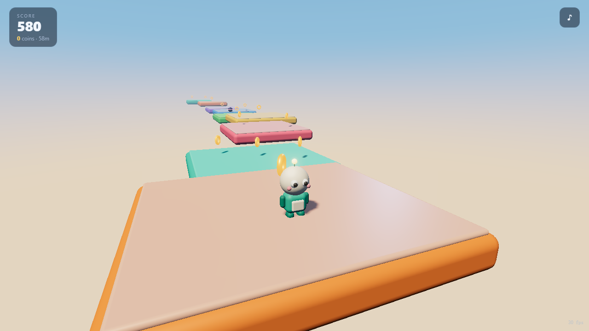
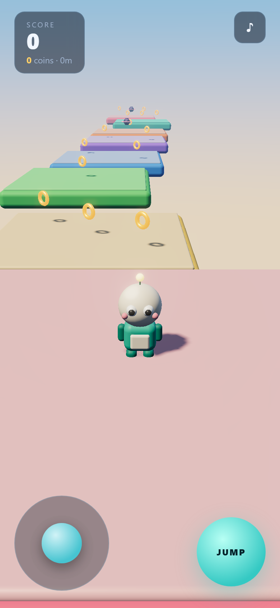

# SKYRUNNER

An endless 3D platformer that runs in the browser — desktop and phone. No build step, no engine, no external art assets: one `index.html`, one ES module, and a vendored copy of three.js.

**Play:** https://13shisan53.github.io/skyrunner-3d/





## Controls

**Desktop**

| Input | Action |
| --- | --- |
| `W A S D` / arrows | move (camera relative) |
| `Space` | jump — hold for height, tap for a short hop |
| Mouse drag | orbit the camera |
| `Shift` | sprint |
| `R` | restart |
| `M` | mute |

**Phone / tablet** — a virtual stick appears bottom-left, a jump button bottom-right, and dragging anywhere else on the screen orbits the camera. The layout respects safe-area insets on notched devices.

## How it plays

Endless: the course is generated ahead of you and recycled behind you, so there is no finish line — only the next platform.

- **Score** = `10 × metres + 100 × coins`. Stomping a drone is worth 2 coins.
- **Difficulty ramps** with distance: platforms shrink from ~9 m to ~4 m, gaps widen from 2 m to 4.3 m.
- Falling below the course ends the run; your best score is kept in `localStorage`.
- Drones patrol on three axes. Landing on top stomps them; hitting one from the side costs coins and knocks you back.

## What's in the engine

- **Momentum movement** — separate ground/air acceleration, ground friction, sprint multiplier.
- **Forgiving jump** — 0.11 s coyote time, 0.12 s jump buffer, variable height, stronger gravity while falling.
- **Kinematic AABB collision** resolved per axis, vertical first (resolving the ground before horizontal sweeps is what stops the character being shoved off ledges).
- **Procedural world** — platforms, coins and drones are generated in segments and disposed once behind the camera; geometry and materials are cached.
- **Cartoon character** — rounded-box body, sphere head, eyes, cheeks, antenna and swinging limbs, all built from primitives at runtime.
- **Rendering** — PCF soft shadows, ACES filmic tone mapping, gradient skydome, emissive materials through UnrealBloom, projected contact shadow.
- **Audio** — every sound effect and the background music are synthesised live with WebAudio. There are no audio files in the repo.

## Music

The background loop is an original piece written for this project: a D-major pentatonic piano arpeggio over a four-chord pad progression (Dmaj9 – Bm9 – Gmaj9 – A9), with bass and hi-hats, all scheduled from code at 88 BPM.

It is **not** a cover or a reproduction of any existing song. If you want a specific track in the game, the honest way to do it is to licence the recording and load it as an audio file — I can wire that up, but I can't ship someone else's composition as generated code.

## Structure

```
index.html                     shell, HUD, overlays, touch controls, import map
src/main.js                    the whole game
vendor/three.module.js         three.js r160 (vendored, no CDN at runtime)
vendor/addons/...              postprocessing passes + RoundedBoxGeometry
test/cdp-test.mjs              headless functional test (desktop + mobile emulation)
test/shot.mjs                  screenshot harness
```

## Run locally

ES modules need a real HTTP origin — opening the file directly will not work.

```bash
python -m http.server 8123
# then open http://127.0.0.1:8123/
```

## Tests

The functional test drives the running game over the Chrome DevTools Protocol and asserts the things that break silently: movement, staying on the platform, jumping, coin pickup, endless generation, the game-over state, restart, and — in a second pass with mobile emulation — that the touch UI appears, the joystick moves the character and the jump button works. It also fails on any uncaught exception or console error.

```bash
# terminal 1
python -m http.server 8123
# terminal 2 — Chrome started with --remote-debugging-port=9333
node test/cdp-test.mjs
```

## Notes

- Everything is original: geometry is built from primitives at runtime, textures are generated on canvas, sounds and music are synthesised. No third-party characters, models or audio files are included.
- three.js is MIT licensed and vendored in `vendor/`.
