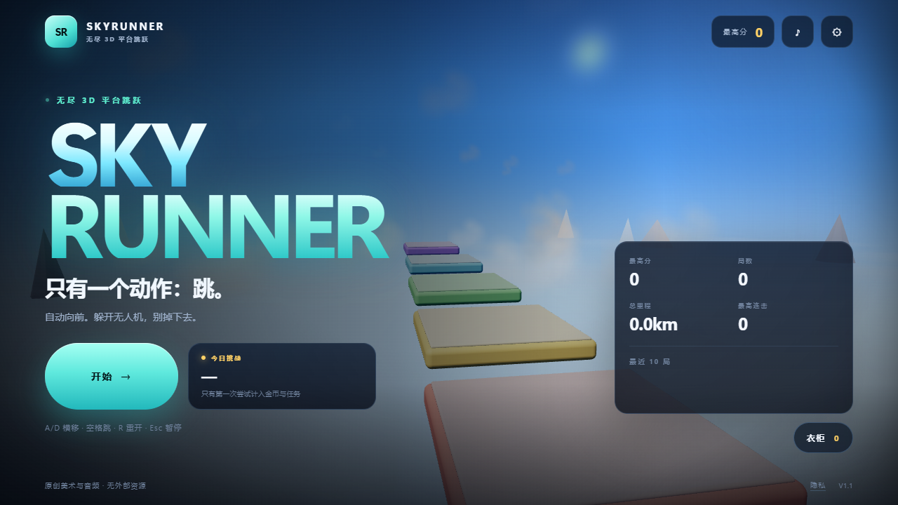
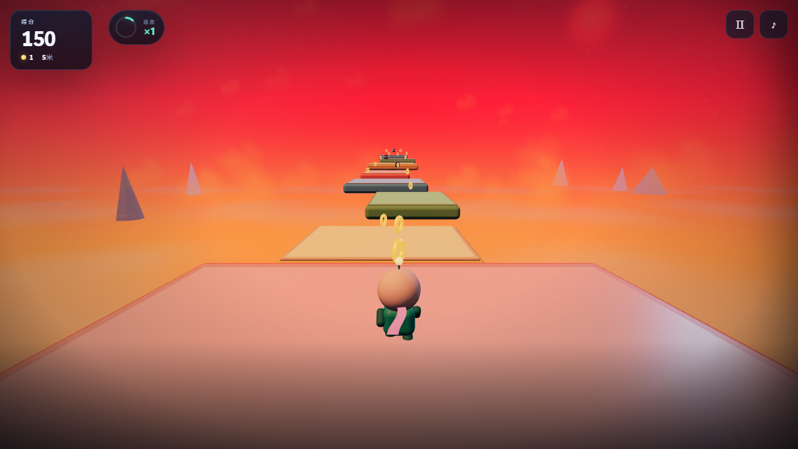
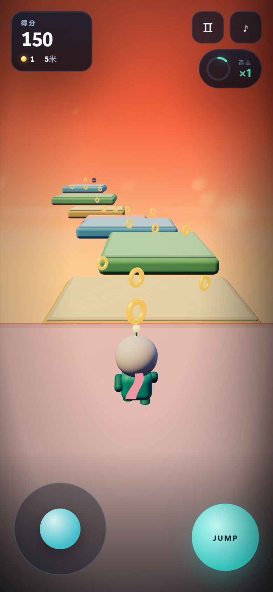

# SKYRUNNER v1.1

An endless 3D platformer that runs in the browser — desktop and phone. One thumb, one verb: **jump**. Auto-run, steer, collect, stomp, don't fall.

**Play locally**

```bash
python -m http.server 8123 --bind 127.0.0.1
# open http://127.0.0.1:8123/
```

No build step. No runtime network calls. No accounts, ads, or backend.





## What changed in v1.1

- **Auto-run**: the course always moves forward; the player only jumps and steers. A/D or ←/→ steer, Space jumps (hold for height), Esc pauses, R restarts, M mutes.
- **Cloud archipelago**: gradient sky with sun, layered cloud fields, a cloud sea, distant peaks, biome colour scripts (dawn → noon → dusk → night) and floating platform art with shape emblems for colour-blind play.
- **"Almost" loop**: a live record tracker, edge saves, drone grazes, a one-hit shield, combo multipliers, a slow-motion death, and a results screen whose headline is how close you were.
- **Meta game**: persistent coins, 4 characters, 4 trails, 3 daily missions, a seeded daily challenge, best score and last-10-runs sparkline.
- **Performance**: adaptive high/mid/low tiers (DPR, shadows, clouds, particles), a fixed 120 Hz simulation with render interpolation, cached geometry/materials and pooled particles.
- **Accessibility**: low-stim mode, reduced motion, keyboard-only play, visible focus, no >3 Hz flashing, shape-marked platforms.
- **i18n**: complete `zh-CN` and `en` catalogues in `src/strings.js`.
- **Privacy**: local-only stats with an opt-out switch and `privacy.html`; no network egress.

## Controls

| Input | Action |
| --- | --- |
| `A` / `D`, `←` / `→` | steer (world X; camera orbit is cosmetic) |
| `Space` | jump — hold for height, tap for a hop |
| `Esc` | pause |
| `R` | restart |
| `M` | mute |
| Mouse/touch drag | orbit the camera (clamped, auto-recentres) |
| Touch | left stick steers, right button jumps, drag elsewhere to look |

## Structure

```
index.html                  shell, HUD, overlays, settings, locker, import map
styles.css                  design system and responsive layout
src/main.js                 boot, state machine, fixed loop, wiring
src/config.js               all tunables, biomes, quality tiers, unlocks
src/strings.js              zh-CN / en copy
src/gen.js                  seeded course generator + fairness rules
src/physics.js              kinematic AABB, per-axis resolution, edge forgiveness
src/player.js               auto-run movement, jump feel, procedural character
src/world.js                endless course, coins, drones, shields, scenery
src/camera.js               spring arm, FOV, shake, menu orbit
src/fx.js                   pooled particles, trail ribbon, speed lines
src/audio.js                procedural SFX and layered music
src/quality.js              frame-time judge
src/meta.js                 save, unlocks, missions, daily seed
src/ui.js                   menu, HUD, results, settings, locker
src/analytics.js            local-only event log
test/                       unit, E2E, performance, screenshots
docs/shots/                 current screenshots
docs/superpowers/           design doc and implementation plan
```

## Tests

Requirements: Python 3.9+, Chrome, Node 24+.

```bash
npm test                 # unit + E2E (starts server and headless Chrome)
npm run test:perf        # E2E + GPU performance run
npm run shots            # regenerate docs/shots
```

The harness starts `python -m http.server 8123` and headless Chrome on ports 9333/9335. Unit tests are pure Node (`node:test`). E2E drives the real game over CDP; it asserts auto-run, steering, jump height, coins, stomps, shields, edge saves, pause/blur, restart, settings persistence, unlocks, daily seed, mobile touch controls, and zero uncaught exceptions.

### Measured performance

AMD Radeon 610M · Chrome · 1280×720 · DPR 1 · headless GPU (`--use-angle=d3d11`), high tier:

| Metric | Result |
| --- | --- |
| Average | **~80–110 fps** |
| p50 / p95 / p99 | **~8–11 / ~17–22 / ~22–24 ms** |
| Long frames (>50 ms) | **0** |
| Draw calls / triangles | **~93 / ~33k** |
| JS heap | **~34–40 MB** |

Soft-rendered Chrome (SwiftShader) is slower; the adaptive quality manager drops DPR, shadows, clouds and particles to keep it playable.

## Art and audio

Everything is generated in code: rounded-box geometry, procedural character, canvas textures, point-cloud clouds, instanced peaks, WebAudio synthesis. The music is an original 92 BPM Dmaj9–Bm9–Gmaj9–A9 loop with pad, arpeggio, bass and hats; layers open up with speed and combo. No audio files are included.

## Notes

- three.js r160 is vendored under `vendor/` (MIT).
- Save key: `skyrunner.save.v2`; analytics key: `skyrunner.analytics.v1`.
- The game still works if `localStorage` is unavailable; it simply does not persist.
- Privacy details: [privacy.html](privacy.html).
