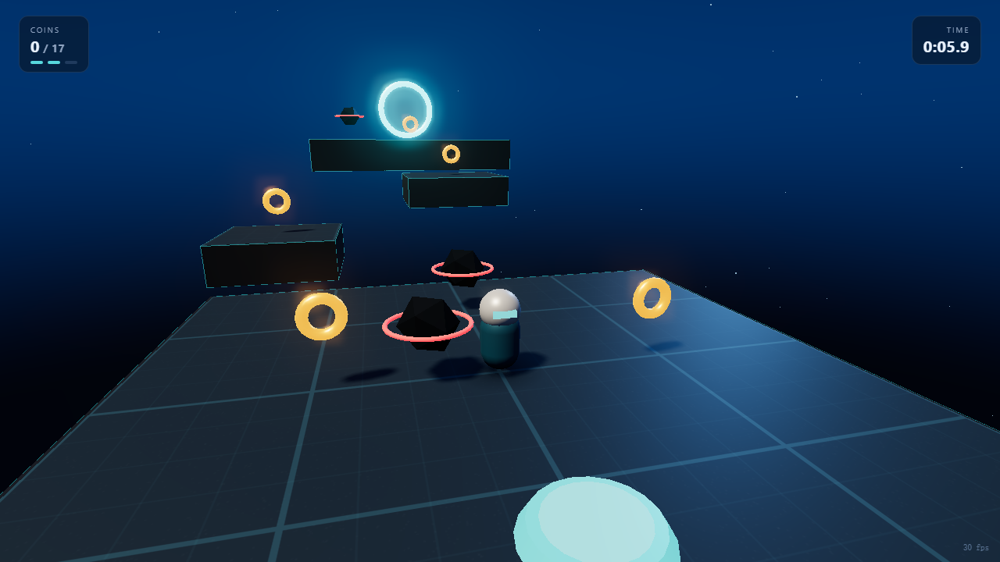

# SKYRUNNER

A small 3D platformer that runs in the browser. No build step, no engine, no external art — one `index.html`, one ES module, and a vendored copy of three.js.

**Play:** https://13shisan53.github.io/skyrunner-3d/



## Controls

| Input | Action |
| --- | --- |
| `W A S D` / arrows | move (camera relative) |
| `Space` | jump — hold for height, tap for a short hop |
| Mouse drag | orbit the camera |
| `Shift` | sprint |
| `R` | restart the run |

## What's in it

- **Movement with momentum** — separate ground/air acceleration, ground friction, sprint multiplier, and a soft speed cap instead of instant velocity changes.
- **Forgiving jump** — 0.11 s coyote time, 0.12 s jump buffer, variable jump height via gravity scaling, higher gravity while falling so descents feel snappy rather than floaty.
- **Kinematic AABB collision** resolved per axis, vertical first (resolving the ground before horizontal sweeps is what stops the character being shoved off ledges).
- **Enemies** patrol on three axes; landing on one stomps it, touching it from the side costs a life.
- **Two checkpoints**, a jump pad, 17 collectibles, and a finish ring.
- **Rendering** — PCF soft shadows, ACES filmic tone mapping, exponential fog, a hand-written gradient skydome, emissive materials feeding an UnrealBloom pass, plus a projected contact shadow so the character never looks like it is floating.
- **Synthesised audio** — every sound is generated with WebAudio oscillators at runtime; there are no audio files.

## Structure

```
index.html            page shell, HUD, start/win overlays, import map
src/main.js           the whole game (~800 lines)
vendor/three.module.js         three.js r160 (vendored, no CDN at runtime)
vendor/addons/...              postprocessing passes used by the bloom chain
test/cdp-test.mjs     headless functional test (Chrome DevTools Protocol)
test/shot.mjs         screenshot harness
```

## Run locally

ES modules need a real HTTP origin — opening the file directly will not work.

```bash
python -m http.server 8123
# then open http://127.0.0.1:8123/
```

## Tests

The functional test drives the game through CDP and asserts the things that are easy to break silently: that the player moves, stays on the platform, can jump, picks up a coin, and triggers the win state — and that no exception or console error was raised.

```bash
# terminal 1
python -m http.server 8123
# terminal 2 — Chrome must be started with --remote-debugging-port=9333
node test/cdp-test.mjs
```

## Notes

- Everything here is original: geometry is built from primitives at runtime, textures are generated on a canvas, and sounds are synthesised. No third-party characters, models, or assets are included.
- three.js is MIT licensed and vendored in `vendor/` so the page has no runtime dependency on a CDN.
